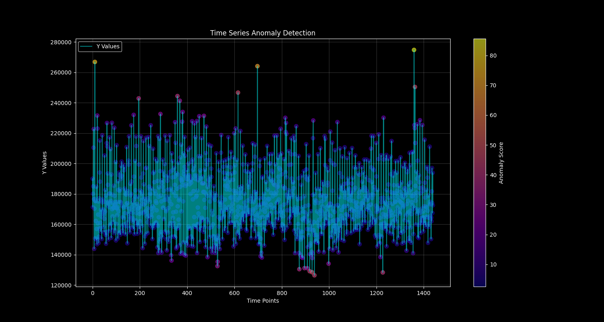

# Time Series Anomaly Detection using Random Cut Forest

This project implements an anomaly detection system using Random Cut Forest (RCF) algorithm for time series data. The system is designed to detect anomalies in time-based measurements while considering multiple temporal features.



## Components

### 1. Random Cut Forest (RCF)
Random Cut Forest is an unsupervised machine learning algorithm that excels at detecting anomalies in multi-dimensional data. It works by:
- Building multiple random trees
- Measuring how isolated points are in the feature space
- Calculating anomaly scores based on point isolation
- Identifying anomalies as points with unusually high isolation scores

### 2. train.py
The training script that:
- Loads time series data from `logs-data.csv`
- Creates and trains a Random Cut Forest model
- Calculates anomaly scores for all data points
- Determines an anomaly threshold (95th percentile)
- Saves the trained model to `rrcf_model.pkl`
- Generates a visualization of the results in `anomaly_detection.png`

### 3. serve.py
A FastAPI-based REST API that:
- Loads the trained RCF model
- Provides endpoints for anomaly detection
- Accepts time-based data points with features:
  - hour (0-23)
  - minute (0-59)
  - y (measurement value)
- Returns anomaly detection results including:
  - is_anomaly (boolean)
  - anomaly_score
  - anomaly_score_threshold
  - time components
  - input value

### 4. test.py
A testing script that:
- Generates test samples with both normal and anomalous values
- Tests the API endpoints
- Displays results in a formatted table
- Includes edge cases and random samples

## Getting Training Data

### From OpenObserve

1. Log into your OpenObserve instance
2. Navigate to the SQL query interface
3. Use the following SQL query to get time-based aggregated data:

```sql
SELECT 
    date_part('hour', to_timestamp(_timestamp / 1000000)) AS hour,
    date_part('minute', to_timestamp(_timestamp / 1000000)) AS minute,
    COUNT(*) AS y
FROM "default"
GROUP BY hour, minute
ORDER BY hour, minute
LIMIT 2000
```

You can modify this query based on your specific needs:
- Change the `LIMIT` to get more or fewer data points
- Add `WHERE` clauses to filter specific time ranges or conditions
- Modify the aggregation function (COUNT) to use other metrics like AVG, SUM, etc.
- Add additional columns for more features

4. Download the query results as a CSV file
5. Save the file as `logs-data.csv` in the project directory

### Data Format Requirements

Data contain the following columns:
- `hour`: Hour of the day (0-23)
- `minute`: Minute of the hour (0-59)
- `y`: The value to monitor for anomalies

SQL query takes care of it.

## Training the Model

Once you have your data file ready:

1. Install the required dependencies:
```bash
pip install numpy rrcf matplotlib duckdb tqdm
```

2. Run the training script:
```bash
python train.py
```

The script will:
- Load and process your data
- Train a Random Cut Forest model
- Calculate anomaly scores
- Generate a visualization of the results
- Save the trained model to `rrcf_model.pkl`

## Output

The training process generates:
- `rrcf_model.pkl`: The trained model file
- `anomaly_detection.png`: A visualization showing the time series data with anomaly scores

## Usage

1. Train the model:
```bash
python train.py
```

2. Start the API server:
```bash
python serve.py
```

3. Run tests:
```bash
python test.py
```

## Data Format
The system expects input data in the following format:
```csv
hour,minute,y
0,0,241709
0,1,221725
```

## API Endpoints

- `GET /`: Welcome message
- `POST /detect_anomaly`: Detect anomalies in a data point
- `GET /model_info`: Get information about the trained model


# OpenObserve implementation

- anomaly_detector_scheduled - This is a scheduled alert that will pull last 1 minute data and get hour, minute, count(events). It will then check if the data is anomalous. It will store the data in a stream `log_volume_anomaly` with anomaly=true/false.
- anomaly_detector_alert - An real time alert that will fire when `anomaly=true` in `log_volume_anomaly` stream

