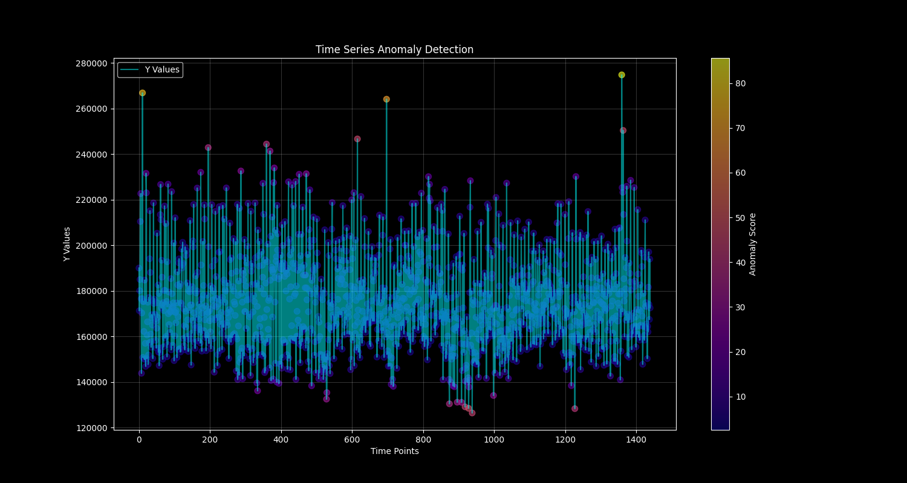
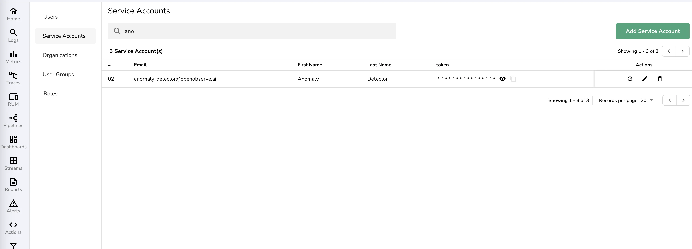
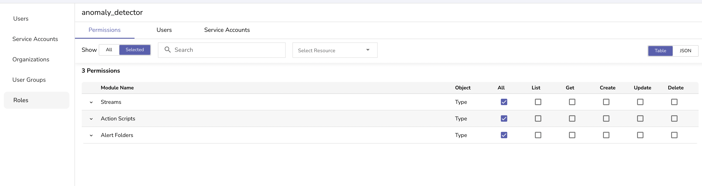
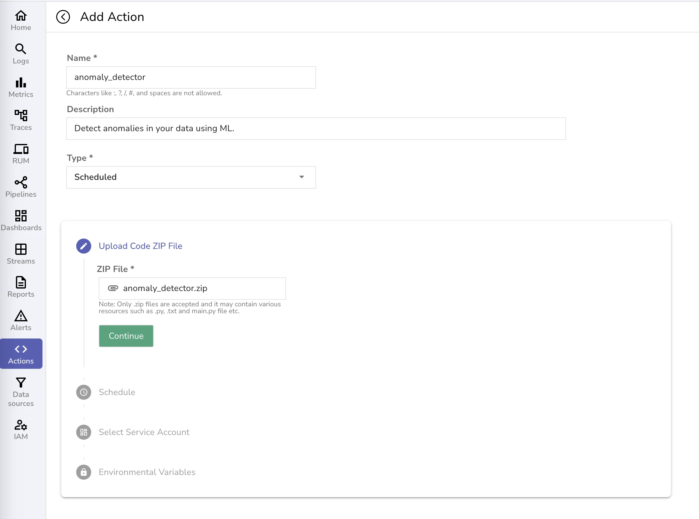
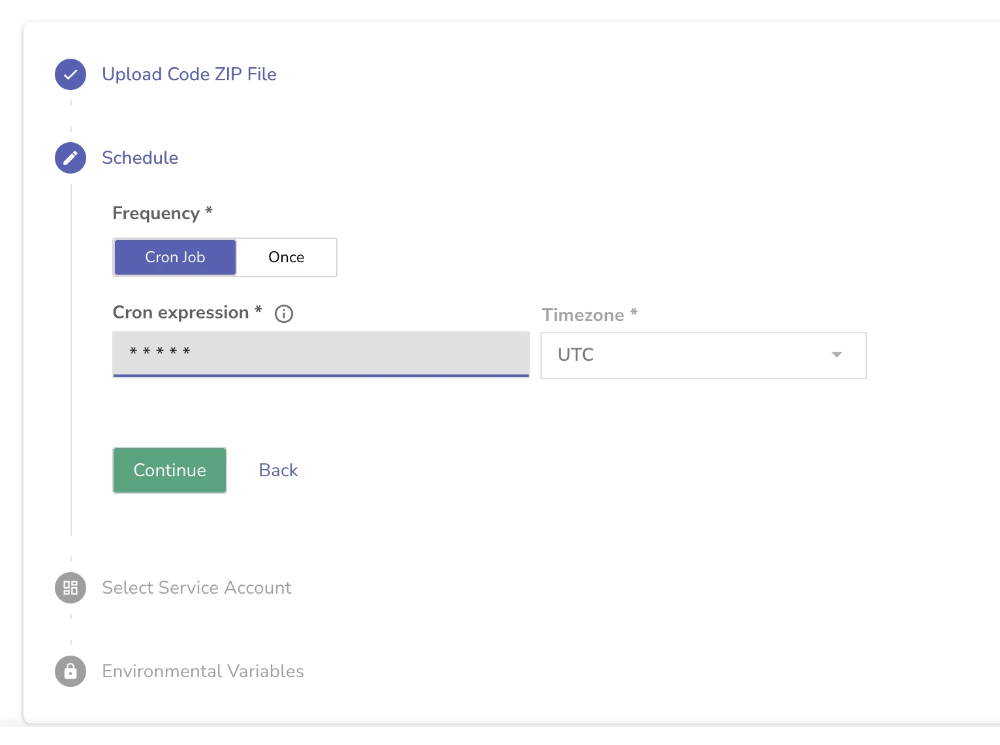
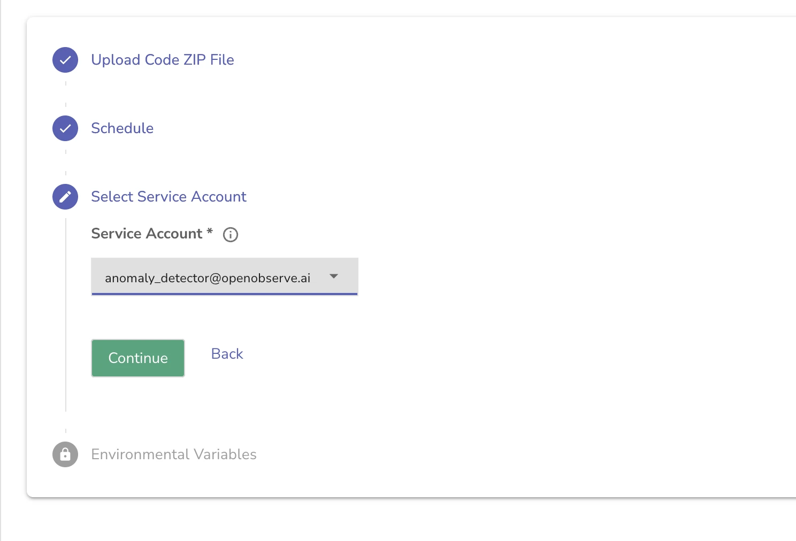
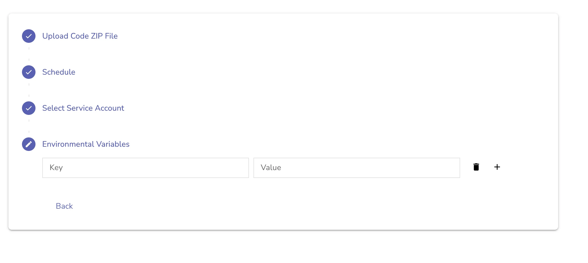
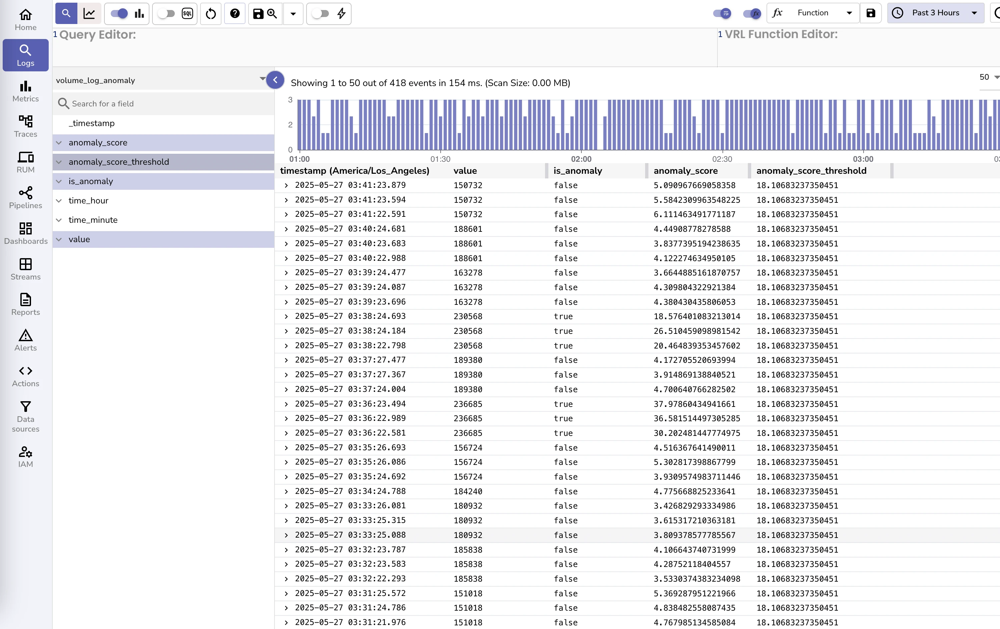

# Implementing Real-time Anomaly Detection with OpenObserve and Random Cut Forest



## What is OpenObserve?

OpenObserve is a powerful open-source observability platform that helps organizations collect, process, and analyze their logs, metrics, and traces. It provides a unified interface for monitoring and debugging applications, making it easier to identify and resolve issues in real-time. With its flexible architecture and robust API, OpenObserve enables seamless integration with various tools and services for enhanced observability.

## Understanding Anomaly Detection

Anomaly detection is a crucial technique in monitoring systems that helps identify unusual patterns or behaviors that deviate from normal operations. These anomalies could indicate potential issues, security threats, or opportunities for optimization. In the context of observability, anomaly detection helps teams proactively identify problems before they impact users or system performance.

## Random Cut Forest: A Powerful ML-based Anomaly Detection Algorithm

Random Cut Forest (RCF) is an unsupervised machine learning algorithm specifically designed for anomaly detection in streaming data. Unlike traditional statistical methods, RCF excels at detecting anomalies in high-dimensional, real-time data streams without requiring labeled training data.

### How Random Cut Forest Works

The algorithm operates on a simple yet powerful principle: anomalous points are easier to isolate than normal points. Here's how it works:

1. **Forest Construction**: Creates multiple random decision trees (typically 100-256 trees for optimal performance)
2. **Random Cuts**: Each tree is built by making random cuts through the feature space, effectively partitioning the data
3. **Isolation Measurement**: For each data point, measures how many cuts are needed to isolate it from other points
4. **Anomaly Scoring**: Calculates an anomaly score based on the average isolation depth across all trees

### Key Algorithm Parameters

- **Number of Trees**: We use 100 trees in our implementation, providing a good balance between accuracy and computational efficiency
- **Tree Depth**: Automatically determined based on data size, typically log₂(n) where n is the sample size
- **Sample Size**: Each tree uses a subset of data points (default: 256 samples per tree)
- **Shingle Size**: For time series data, combines consecutive time points into feature vectors

### Anomaly Score Interpretation

In our implementation, we use the 98th percentile as the threshold, meaning points scoring higher than 98% of training data are flagged as anomalous.

### When to Use Random Cut Forest

RCF is particularly well-suited for:

**✅ Ideal Use Cases:**
- **Streaming data**: Real-time anomaly detection with low latency
- **High-dimensional data**: Works well with multiple features hour (0-23), minute (0-59), and log volume (event count)
- **Unknown anomaly patterns**: No prior knowledge of what anomalies look like
- **Concept drift**: Adapts to changing data patterns over time
- **Numerical features**: All input features should be numeric

**❌ Consider Alternatives For:**
- **Categorical data**: Requires preprocessing to convert to numerical features
- **Very small datasets**: Needs sufficient data for reliable tree construction
- **Known anomaly patterns**: Rule-based systems might be more efficient
- **Seasonal data**: May need additional preprocessing for strong seasonal patterns

### Advantages Over Other Methods

| Algorithm | Real-time | No Labels Needed | High-Dimensional | Memory Efficient |
|-----------|-----------|------------------|------------------|------------------|
| **Random Cut Forest** | ✅ | ✅ | ✅ | ✅ |
| Isolation Forest | ❌ | ✅ | ✅ | ❌ |
| LSTM Autoencoders | ❌ | ✅ | ✅ | ❌ |
| Statistical Methods | ✅ | ✅ | ❌ | ✅ |
| SVM | ❌ | ❌ | ✅ | ❌ |

### Performance Characteristics

- **Memory Usage**: O(n) where n is the sample size per tree
- **Training Time**: O(n log n) per tree
- **Prediction Time**: O(log n) per point - excellent for real-time applications
- **Accuracy**: Typically achieves 85-95% accuracy on time series anomaly detection tasks

## Prerequisites
- OpenObserve version 0.14.7+ with Actions enabled
- OpenObserve cluster with administrative access
- Python 3.8+ with pip
- Minimum 24 hours of historical log data
- Basic familiarity with SQL and Python

## Implementation Guide

In this exercise we will train the model on last one day of data. We will extract the hour, minute and log volume (event count) from the stream using a SQL query:


```sql
SELECT 
        date_part('hour', to_timestamp(_timestamp / 1000000)) AS hour,
        date_part('minute', to_timestamp(_timestamp / 1000000)) AS minute,
        COUNT(*) AS y
    FROM "default"
    GROUP BY hour, minute
    ORDER BY hour, minute
    LIMIT 2000
```

Here we have 3 features (hour, minute and event count). The above SQL query when run for 1 day will return 1440 records (24*60) for training the model. You can have more than 2 features as well. Make sure that all the features are numeric. If you have non-numeric features you will need to convert them into numeric features. 

Following are high level steps:

- Train the model. 
- Score the points to identify optimal 98 percentile anomaly score. Any points that are not within 98 percentile will be treated as anomaly.
- Package the model.
- Deploy it in a scheduled action. This scheduled action will run every 1 minute, pick the last 1 minute data using the above SQL query, and check it against the model.
- Scheduled action will then push the results it gets from the model to a stream `volume_log_anomaly` that will hold historical data of anomalies (true or false)
- Create an real time alert on `volume_log_anomaly` stream for `anomaly=true`

We will also need to grant access using service accounts. Implementation steps are below.

### 1. Setting Up OpenObserve Service Account

First, we need to create a service account in OpenObserve with appropriate permissions. These permissions will be used by us to deploy the service account as well as for the service account to run:

1. Create a service account named `anomaly_detector_serviceaccount@openobserve.ai`



2. Create a role named `anomaly_detector` with the following permissions:
   - Streams: All
   - Action Scripts: All
   - Alert Folders: All



3. Attach service account to the role.

### 2. Configuration and Environment Setup

Now that you have created the service account and obtained the credentials, we need to configure our local environment. These credentials will be used for:

- **Training script (`train.py`)**: To fetch historical data from OpenObserve for model training
- **Deployment script (`deploy.py`)**: To upload and deploy the anomaly detection action to OpenObserve
- **Runtime authentication**: For the deployed action to access OpenObserve APIs and write results

#### Setting Up Environment Variables

Create a `.env` file in your project root with your OpenObserve service account credentials:

```env
# OpenObserve cluster configuration
ORIGIN_CLUSTER_URL=https://your-cluster.openobserve.ai
ORIGIN_CLUSTER_TOKEN=your_base64_encoded_service_account_token
OPENOBSERVE_ORG=your_organization_name
```

This is going to be used only during development and testing. Once deployed as an action, these environment variables will be supplied to the application by OpenObserve.

#### Environment Variables Explained:

- **`ORIGIN_CLUSTER_URL`**: Your OpenObserve cluster endpoint URL
- **`ORIGIN_CLUSTER_TOKEN`**: Base64-encoded service account token from the previous step
- **`OPENOBSERVE_ORG`**: Your organization name in OpenObserve

The above environment variables are available to the application automatically when running as an `Action`

#### Security Best Practices:

⚠️ **Important Security Notes:**
- Add `.env` to your `.gitignore` file to prevent committing credentials
- Use environment-specific service accounts for dev/staging/production
- Rotate service account tokens regularly (quarterly recommended)
- Limit service account permissions to only what's needed

#### Validating Configuration

Before proceeding with training, verify your configuration:

```python
# Quick validation script
import os
from dotenv import load_dotenv

load_dotenv()

required_vars = ['ORIGIN_CLUSTER_URL', 'ORIGIN_CLUSTER_TOKEN', 'OPENOBSERVE_ORG']
missing_vars = [var for var in required_vars if not os.getenv(var)]

if missing_vars:
    print(f"Missing required environment variables: {missing_vars}")
else:
    print("✅ Configuration validated successfully!")
```

### 3. Training the Model

The `train.py` script implements a comprehensive training workflow designed for production reliability:

#### Data Requirements and Quality

Before training, ensure you have:
- **Minimum 24 hours of continuous data** (1440 data points for minute-level aggregation)
- **Consistent data patterns** without major gaps or missing timestamps
- **Representative baseline behavior** - avoid training during known outage periods
- **Sufficient data volume** - at least 1000+ log events per minute for reliable patterns

#### Training Workflow

The training process follows these detailed steps:

1. **Data Extraction**: Fetches time series data from OpenObserve using our SQL query
2. **Data Preprocessing**: 
   - Validates data completeness and fills minor gaps
   - Normalizes features to ensure balanced contribution to anomaly scores
   - Creates sliding time windows for temporal pattern recognition
3. **Model Training**: Trains a Random Cut Forest model with 100 trees optimized for streaming data
4. **Anomaly Score Calculation**: Processes all training data through the model to establish baseline scores
5. **Threshold Optimization**: Determines the optimal anomaly threshold using statistical analysis
6. **Validation**: Tests the model against known patterns to ensure reasonable behavior
7. **Model Persistence**: Saves the trained model and metadata for deployment

#### Threshold Selection: Why 98th Percentile?

The choice of 98th percentile as our anomaly threshold is based on practical considerations:

**Why 98th Percentile:**
- **Balanced Sensitivity**: Catches significant anomalies while avoiding excessive noise
- **Industry Standard**: Commonly used in production systems for log volume monitoring
- **Manageable Alert Volume**: Generates approximately 1-2% of data points as anomalies (about 14-29 alerts per day).

**Threshold Trade-offs:**

| Threshold | False Positives | False Negatives | Use Case |
|-----------|----------------|-----------------|-----------|
| **95th percentile** | High (5% of data) | Low | Development/testing environments |
| **98th percentile** | Moderate (2% of data) | Moderate | **Production systems (recommended)** |
| **99th percentile** | Low (1% of data) | High | Critical systems with low tolerance for alerts |
| **99.5th percentile** | Very Low (0.5% of data) | Very High | Only for detecting severe anomalies |

#### Customizing the Threshold

You can adjust the threshold based on your operational needs:

```python
# In train.py, modify the threshold calculation:
# For more sensitive detection (more alerts):
threshold = np.percentile(scores, 95)  # 95th percentile

# For less sensitive detection (fewer alerts):
threshold = np.percentile(scores, 99.5)  # 99.5th percentile
```

**Choosing Your Threshold:**
- **Start with 98th percentile** for initial deployment
- **Monitor alert volume** for the first week
- **Adjust based on feedback** from your operations team
- **Consider your on-call capacity** - higher thresholds mean fewer but more critical alerts

#### Training Data Considerations

**Seasonal Patterns:**
- Train on data that includes typical weekly patterns (weekdays vs. weekends)
- Consider retraining monthly to capture evolving usage patterns
- For applications with strong seasonal behavior, consider training on longer periods with date and month features

**Data Quality Validation:**
The training script automatically validates:
- No more than 5% missing data points
- Consistent timestamp intervals
- Reasonable value ranges (no negative counts, extreme outliers)

**Performance Monitoring:**
After training, the model outputs:
- **Training data coverage**: Percentage of time periods included
- **Anomaly distribution**: How scores are distributed across the training set
- **Model confidence metrics**: Internal validation scores for model reliability

#### Retraining Strategy

**Weekly Retraining (Recommended):**
- Captures evolving application patterns
- Maintains model accuracy as usage grows
- Automated via `deploy.py` script

**Trigger-based Retraining:**
Consider immediate retraining if:
- Application undergoes major changes
- Alert volume increases significantly (>3x normal)
- Model confidence drops below acceptable levels

The script uses a streaming approach to calculate anomaly scores, making it suitable for real-time applications while maintaining the statistical properties learned during training.

### 4. Testing

The implementation includes three main components:

- `serve.py`: Creates a REST API endpoint for real-time anomaly detection
- `test.py`: Demonstrates how to use the API with sample data

### 5. Deployment

Deployment is done using the below script.

- `deploy.py`: Handles the complete workflow of training, packaging, and deploying the anomaly detection action.

You could also run `pack.sh` to create the zip file and deploy the action manually.






The deployment process can be automated to run weekly, ensuring the model stays up-to-date with the latest data patterns.

## Results and Visualization of training and deployment

### Visualizing training data results
The system generates an `anomaly_detection.png` visualization that shows:
- Time series data
- Anomaly scores represented as a color gradient
- Clear identification of anomalous points


The visualization helps teams quickly identify patterns and anomalies in their data.

Above is based on training data. Now we should let the action run for a couple of hours.

### Visualizing anomalies in real time

After the action has run for a couple of hours you will see the data in the log stream.



You will notice that whenever the value is higher than usual (generally above 230,000) `is_anomaly` is marked true.

You can now create a real time alert based on this stream which will notify you of anomalies in real time.

### Common Issues
- **Model returns all anomalies**: Check if training data includes sufficient normal patterns
- **High false positive rate**: Consider increasing threshold from 98th to 99th percentile
- **Deployment fails**: Verify service account permissions and API endpoints

## Conclusion

This implementation demonstrates how to build a robust anomaly detection system using OpenObserve. The solution is:
- Real-time capable
- Scalable
- Easy to maintain

By regularly retraining the model and monitoring its performance, you can maintain an effective anomaly detection system that helps you stay ahead of potential issues.

