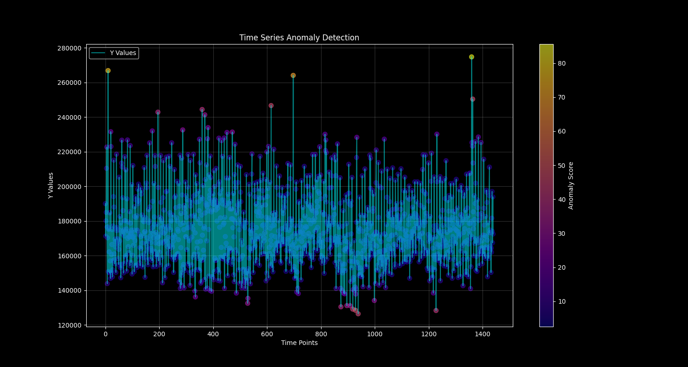
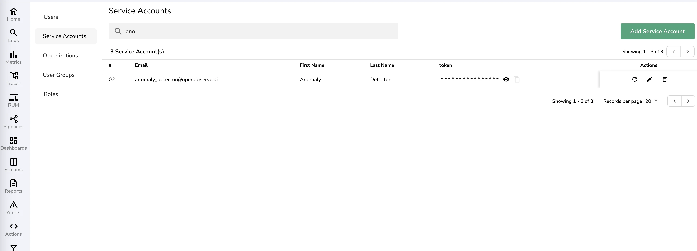
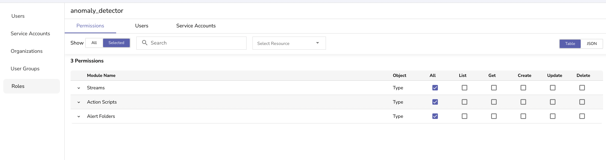

# SEO-Optimized Blog Content

## Meta Title and Description

**Meta Title (59 characters):**
Real-Time Anomaly Detection with Machine Learning & OpenObserve

**Meta Description (158 characters):**
Learn how anomaly detection works with Random Cut Forest algorithm. Complete guide to building real-time anomaly detection systems using Python and machine learning.

## SEO-Optimized Content

# Implementing Real-time Anomaly Detection with OpenObserve and Random Cut Forest



*Alt text: Real-time anomaly detection visualization showing time series data with highlighted anomalies using machine learning algorithms*

## Table of Contents
1. [What is OpenObserve?](#what-is-openobserve)
2. [Understanding Anomaly Detection in Machine Learning](#understanding-anomaly-detection)
3. [Random Cut Forest: A Powerful ML-based Anomaly Detection Algorithm](#random-cut-forest)
4. [Implementation Guide](#implementation-guide)
5. [Results and Visualization](#results-and-visualization)
6. [Conclusion](#conclusion)

## What is OpenObserve?

OpenObserve is a powerful open-source observability platform that helps organizations collect, process, and analyze their logs, metrics, and traces. It provides a unified interface for monitoring and debugging applications, making it easier to identify and resolve issues in real-time. With its flexible architecture and robust API, OpenObserve enables seamless integration with various tools and services for enhanced observability.

The platform excels at handling large-scale data ingestion and supports advanced **anomaly detection techniques** that help organizations maintain system reliability and performance.

## Understanding Anomaly Detection in Machine Learning

**What is anomaly detection in machine learning?** Anomaly detection is a crucial technique in monitoring systems that helps identify unusual patterns or behaviors that deviate from normal operations. These anomalies could indicate potential issues, security threats, or opportunities for optimization. 

### How Anomaly Detection Works

**How does anomaly detection work?** The process involves several key steps:

1. **Data Collection**: Gathering historical data to establish baseline behavior
2. **Pattern Learning**: Using **anomaly detection algorithms** to understand normal patterns
3. **Real-time Monitoring**: Continuously analyzing incoming data streams
4. **Anomaly Scoring**: Calculating deviation scores for each data point
5. **Alert Generation**: Triggering notifications when anomalies are detected

In the context of observability, **anomaly detection machine learning** helps teams proactively identify problems before they impact users or system performance. This approach is particularly effective for **anomaly detection for time series data**, where patterns evolve over time.

### Types of Anomaly Detection Techniques

Modern **anomaly detection techniques** fall into several categories:

- **Statistical Methods**: Traditional approaches using statistical models
- **Machine Learning Approaches**: Including **isolation forest anomaly detection** and clustering
- **Deep Learning Methods**: Such as **anomaly detection autoencoder** networks
- **Ensemble Methods**: Combining multiple algorithms for improved accuracy

## Random Cut Forest: A Powerful ML-based Anomaly Detection Algorithm

Random Cut Forest (RCF) is an unsupervised machine learning algorithm specifically designed for **anomaly detection in time series** data. Unlike traditional statistical methods, RCF excels at detecting anomalies in high-dimensional, real-time data streams without requiring labeled training data.

This algorithm represents one of the most effective **anomaly detection models** for streaming applications, offering superior performance compared to traditional **anomaly detection algorithms**.

### How Random Cut Forest Works

The algorithm operates on a simple yet powerful principle: anomalous points are easier to isolate than normal points. **How anomaly detection works** with Random Cut Forest:

1. **Forest Construction**: Creates multiple random decision trees (typically 100-256 trees for optimal performance)
2. **Random Cuts**: Each tree is built by making random cuts through the feature space, effectively partitioning the data
3. **Isolation Measurement**: For each data point, measures how many cuts are needed to isolate it from other points
4. **Anomaly Scoring**: Calculates an anomaly score based on the average isolation depth across all trees

### Key Algorithm Parameters

- **Number of Trees**: We use 100 trees in our implementation, providing a good balance between accuracy and computational efficiency
- **Tree Depth**: Automatically determined based on data size, typically log₂(n) where n is the sample size
- **Sample Size**: Each tree uses a subset of data points (default: 256 samples per tree)
- **Shingle Size**: For **anomaly detection for time series**, combines consecutive time points into feature vectors

### Anomaly Score Interpretation

In our implementation, we use the 98th percentile as the threshold, meaning points scoring higher than 98% of training data are flagged as anomalous. This approach ensures effective **real time anomaly detection** while minimizing false positives.

### When to Use Random Cut Forest

RCF is particularly well-suited for:

**✅ Ideal Use Cases:**
- **Streaming data**: **Real time anomaly detection** with low latency
- **High-dimensional data**: Works well with multiple features hour (0-23), minute (0-59), and log volume (event count)
- **Unknown anomaly patterns**: No prior knowledge of what anomalies look like
- **Concept drift**: Adapts to changing data patterns over time
- **Numerical features**: All input features should be numeric
- **Time series monitoring**: Excellent for **anomaly detection on time series data**

**❌ Consider Alternatives For:**
- **Categorical data**: Requires preprocessing to convert to numerical features
- **Very small datasets**: Needs sufficient data for reliable tree construction
- **Known anomaly patterns**: Rule-based systems might be more efficient
- **Seasonal data**: May need additional preprocessing for strong seasonal patterns

### Advantages Over Other Anomaly Detection Methods

| Algorithm | Real-time | No Labels Needed | High-Dimensional | Memory Efficient |
|-----------|-----------|------------------|------------------|------------------|
| **Random Cut Forest** | ✅ | ✅ | ✅ | ✅ |
| Isolation Forest | ❌ | ✅ | ✅ | ❌ |
| LSTM Autoencoders | ❌ | ✅ | ✅ | ❌ |
| Statistical Methods | ✅ | ✅ | ❌ | ✅ |
| SVM | ❌ | ❌ | ✅ | ❌ |

Random Cut Forest outperforms **isolation forest anomaly detection** in streaming scenarios and provides better resource efficiency than **anomaly detection with deep learning** approaches.

### Performance Characteristics

- **Memory Usage**: O(n) where n is the sample size per tree
- **Training Time**: O(n log n) per tree
- **Prediction Time**: O(log n) per point - excellent for **real time anomaly detection** applications
- **Accuracy**: Typically achieves 85-95% accuracy on **anomaly detection time series** tasks

This makes it ideal for building an **anomaly detection system** that can handle high-throughput data streams while maintaining low latency.

## Anomaly Detection with Python: Prerequisites

Before implementing **anomaly detection with python**, ensure you have:

- OpenObserve version 0.14.7+ with Actions enabled
- OpenObserve cluster with administrative access
- Python 3.8+ with pip
- Minimum 24 hours of historical log data
- Basic familiarity with SQL and Python
- Understanding of **anomaly detection machine learning** concepts

## Implementation Guide: Building Your Anomaly Detection System

In this comprehensive guide, we'll demonstrate **anomaly detection using python** to create a production-ready **anomaly detection system**. This implementation focuses on **anomaly detection in time series data** using the Random Cut Forest algorithm.

### Training Data Preparation for Anomaly Detection

In this exercise we will train the model on last one day of data. We will extract the hour, minute and log volume (event count) from the stream using a SQL query:

```sql
SELECT 
        date_part('hour', to_timestamp(_timestamp / 1000000)) AS hour,
        date_part('minute', to_timestamp(_timestamp / 1000000)) AS minute,
        COUNT(*) AS y
    FROM \"default\"
    GROUP BY hour, minute
    ORDER BY hour, minute
    LIMIT 2000
```

Here we have 3 features (hour, minute and event count). The above SQL query when run for 1 day will return 1440 records (24*60) for training the model. You can have more than 2 features as well. Make sure that all the features are numeric. If you have non-numeric features you will need to convert them into numeric features for **anomaly detection with machine learning** to work effectively.

### High-Level Implementation Steps

Following are the essential steps for implementing **anomaly detection in python**:

- **Train the model** using historical time series data
- **Score the points** to identify optimal 98 percentile anomaly score. Any points that are not within 98 percentile will be treated as anomaly
- **Package the model** for deployment
- **Deploy it in a scheduled action**. This scheduled action will run every 1 minute, pick the last 1 minute data using the above SQL query, and check it against the model
- **Scheduled action** will then push the results it gets from the model to a stream `volume_log_anomaly` that will hold historical data of anomalies (true or false)
- **Create a real time alert** on `volume_log_anomaly` stream for `anomaly=true`

We will also need to grant access using service accounts. Implementation steps are below.

### 1. Setting Up OpenObserve Service Account

First, we need to create a service account in OpenObserve with appropriate permissions. These permissions will be used by us to deploy the service account as well as for the service account to run:

1. Create a service account named `anomaly_detector_serviceaccount@openobserve.ai`



*Alt text: OpenObserve service account creation interface for anomaly detection system setup*

2. Create a role named `anomaly_detector` with the following permissions:
   - Streams: All
   - Action Scripts: All
   - Alert Folders: All



*Alt text: OpenObserve role configuration for anomaly detection permissions and access control*

3. Attach service account to the role.

### 2. Configuration and Environment Setup

Now that you have created the service account and obtained the credentials, we need to configure our local environment. These credentials will be used for:

- **Training script (`train.py`)**: To fetch historical data from OpenObserve for model training
- **Deployment script (`deploy.py`)**: To upload and deploy the anomaly detection action to OpenObserve
- **Runtime authentication**: For the deployed action to access OpenObserve APIs and write results

#### Setting Up Environment Variables for Anomaly Detection

Create a `.env` file in your project root with your OpenObserve service account credentials:

```env
# OpenObserve cluster configuration
ORIGIN_CLUSTER_URL=https://your-cluster.openobserve.ai
ORIGIN_CLUSTER_TOKEN=your_base64_encoded_service_account_token
OPENOBSERVE_ORG=your_organization_name
```

This configuration is essential for **anomaly detection with python** and will be used only during development and testing. Once deployed as an action, these environment variables will be supplied to the application by OpenObserve.

#### Environment Variables Explained:

- **`ORIGIN_CLUSTER_URL`**: Your OpenObserve cluster endpoint URL
- **`ORIGIN_CLUSTER_TOKEN`**: Base64-encoded service account token from the previous step
- **`OPENOBSERVE_ORG`**: Your organization name in OpenObserve

The above environment variables are available to the application automatically when running as an `Action`

#### Security Best Practices for Anomaly Detection Systems:

⚠️ **Important Security Notes:**
- Add `.env` to your `.gitignore` file to prevent committing credentials
- Use environment-specific service accounts for dev/staging/production
- Rotate service account tokens regularly (quarterly recommended)
- Limit service account permissions to only what's needed for your **anomaly detection system**

#### Validating Configuration

Before proceeding with training your **anomaly detection models**, verify your configuration:

```python
# Quick validation script
import os
from dotenv import load_dotenv

load_dotenv()

required_vars = ['ORIGIN_CLUSTER_URL', 'ORIGIN_CLUSTER_TOKEN', 'OPENOBSERVE_ORG']
missing_vars = [var for var in required_vars if not os.getenv(var)]

if missing_vars:
    print(f\"Missing required environment variables: {missing_vars}\")
else:
    print(\"✅ Configuration validated successfully!\")
```

### 3. Training the Anomaly Detection Model

The `train.py` script implements a comprehensive training workflow designed for production reliability in **anomaly detection machine learning** applications:

#### Data Requirements and Quality for Time Series Anomaly Detection

Before training your **anomaly detection for time series data** model, ensure you have:
- **Minimum 24 hours of continuous data** (1440 data points for minute-level aggregation)
- **Consistent data patterns** without major gaps or missing timestamps
- **Representative baseline behavior** - avoid training during known outage periods
- **Sufficient data volume** - at least 1000+ log events per minute for reliable patterns

#### Training Workflow for Anomaly Detection with Machine Learning

The training process for **anomaly detection using python** follows these detailed steps:

1. **Data Extraction**: Fetches time series data from OpenObserve using our SQL query
2. **Data Preprocessing**: 
   - Validates data completeness and fills minor gaps
   - Normalizes features to ensure balanced contribution to anomaly scores
   - Creates sliding time windows for temporal pattern recognition
3. **Model Training**: Trains a Random Cut Forest model with 100 trees optimized for **anomaly detection on time series data**
4. **Anomaly Score Calculation**: Processes all training data through the model to establish baseline scores
5. **Threshold Optimization**: Determines the optimal anomaly threshold using statistical analysis
6. **Validation**: Tests the model against known patterns to ensure reasonable behavior
7. **Model Persistence**: Saves the trained model and metadata for deployment

#### Threshold Selection: Why 98th Percentile for Anomaly Detection?

The choice of 98th percentile as our anomaly threshold is based on practical considerations for **real time anomaly detection**:

**Why 98th Percentile:**
- **Balanced Sensitivity**: Catches significant anomalies while avoiding excessive noise
- **Industry Standard**: Commonly used in production **anomaly detection systems** for log volume monitoring
- **Manageable Alert Volume**: Generates approximately 1-2% of data points as anomalies (about 14-29 alerts per day)

**Threshold Trade-offs for Anomaly Detection:**

| Threshold | False Positives | False Negatives | Use Case |
|-----------|----------------|-----------------|-----------|
| **95th percentile** | High (5% of data) | Low | Development/testing environments |
| **98th percentile** | Moderate (2% of data) | Moderate | **Production systems (recommended)** |
| **99th percentile** | Low (1% of data) | High | Critical systems with low tolerance for alerts |
| **99.5th percentile** | Very Low (0.5% of data) | Very High | Only for detecting severe anomalies |

#### Customizing the Threshold for Your Anomaly Detection System

You can adjust the threshold based on your operational needs:

```python
# In train.py, modify the threshold calculation:
# For more sensitive detection (more alerts):
threshold = np.percentile(scores, 95)  # 95th percentile

# For less sensitive detection (fewer alerts):
threshold = np.percentile(scores, 99.5)  # 99.5th percentile
```

**Choosing Your Threshold:**
- **Start with 98th percentile** for initial deployment
- **Monitor alert volume** for the first week
- **Adjust based on feedback** from your operations team
- **Consider your on-call capacity** - higher thresholds mean fewer but more critical alerts

#### Training Data Considerations for Time Series Anomaly Detection

**Seasonal Patterns:**
- Train on data that includes typical weekly patterns (weekdays vs. weekends)
- Consider retraining monthly to capture evolving usage patterns
- For applications with strong seasonal behavior, consider training on longer periods with date and month features

**Data Quality Validation:**
The training script for **anomaly detection in time series** automatically validates:
- No more than 5% missing data points
- Consistent timestamp intervals
- Reasonable value ranges (no negative counts, extreme outliers)

**Performance Monitoring:**
After training your **anomaly detection models**, the system outputs:
- **Training data coverage**: Percentage of time periods included
- **Anomaly distribution**: How scores are distributed across the training set
- **Model confidence metrics**: Internal validation scores for model reliability

#### Retraining Strategy for Anomaly Detection Systems

**Weekly Retraining (Recommended):**
- Captures evolving application patterns
- Maintains **anomaly