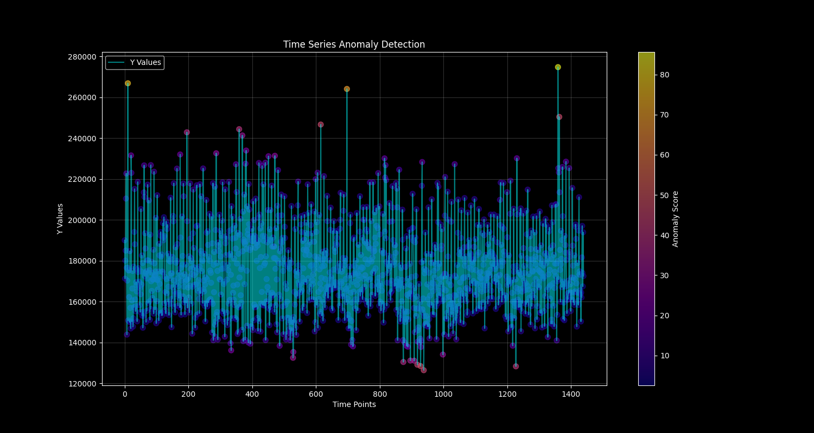
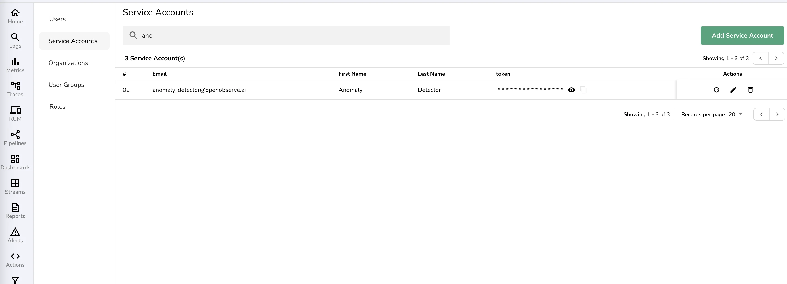
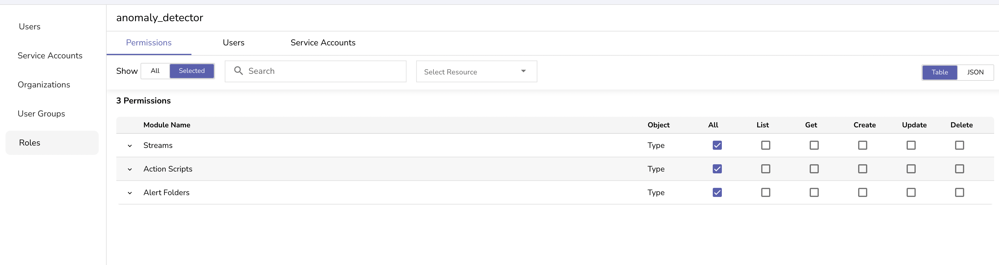
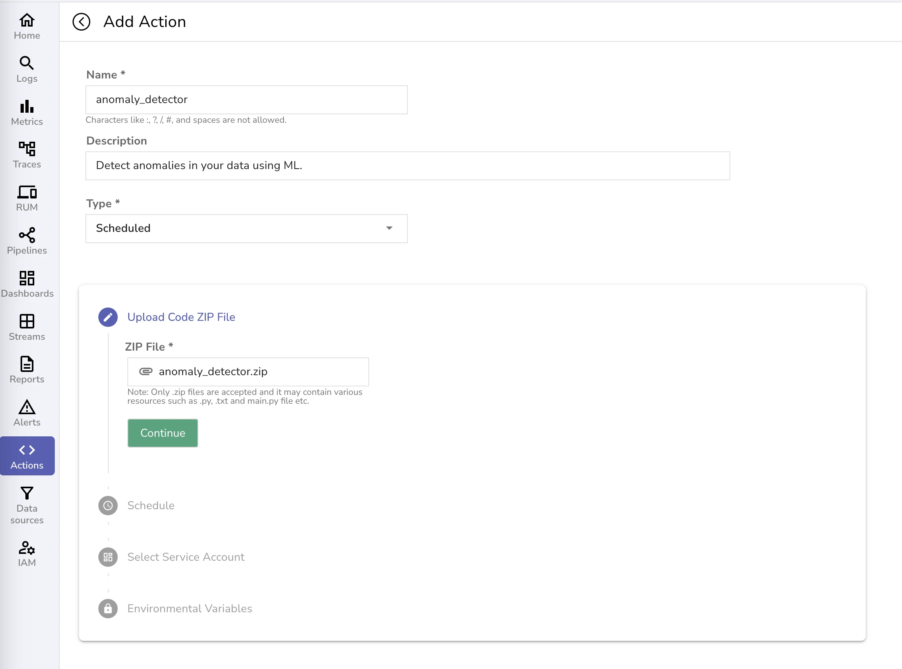
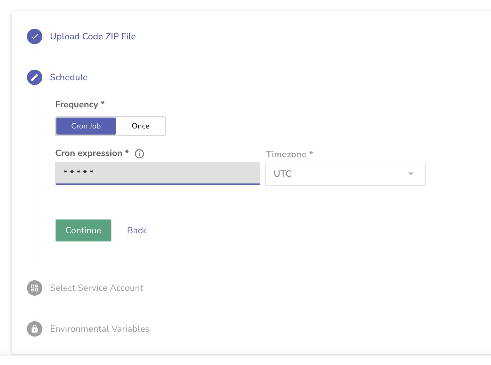
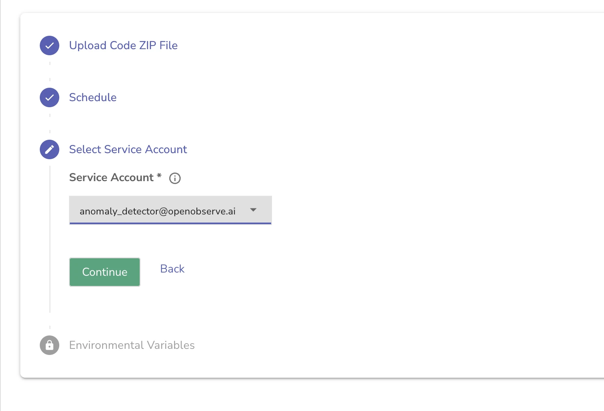
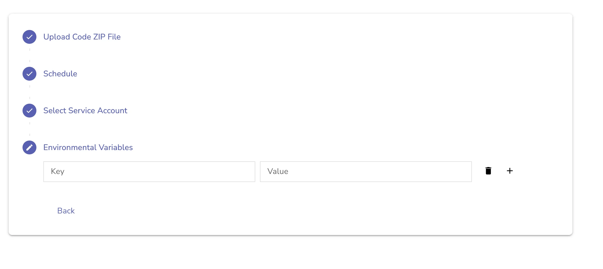
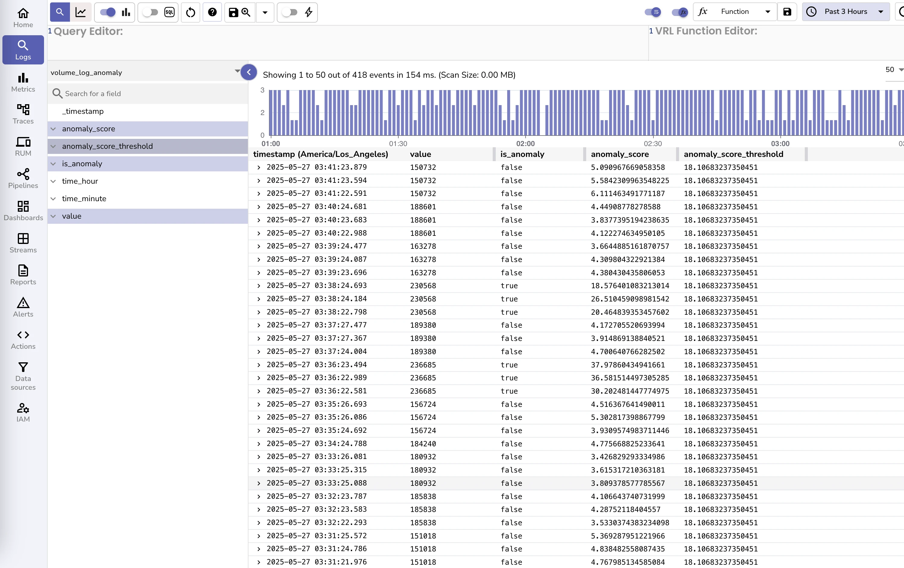

# Implementing Real-time Anomaly Detection with OpenObserve and Random Cut Forest



## Table of Contents
- [What is Anomaly Detection in Machine Learning?](#what-is-anomaly-detection-in-machine-learning)
- [What is OpenObserve?](#what-is-openobserve)
- [How Anomaly Detection Works for Time Series Data](#how-anomaly-detection-works-for-time-series-data)
- [Understanding Random Cut Forest: An Advanced Anomaly Detection Algorithm](#understanding-random-cut-forest-an-advanced-anomaly-detection-algorithm)
- [Implementing Anomaly Detection for Real-Time Monitoring](#implementing-anomaly-detection-for-real-time-monitoring)
- [Common Challenges and Troubleshooting](#common-challenges-and-troubleshooting)
- [Conclusion](#conclusion)
- [FAQs about Anomaly Detection Systems](#faqs-about-anomaly-detection-systems)

---

## What is Anomaly Detection in Machine Learning?

**Anomaly detection in machine learning** is a vital technique which helps automatically identify unusual data patterns within a dataset. Also known as outlier detection, it is crucial in fields such as cybersecurity, finance, IT operations, and system monitoring. In particular, **anomaly detection for time series data** involves recognizing deviations from normal behavior over hours, days, or months, helping teams flag potential incidents before they escalate.

Key use cases for anomaly detection include:
- Fraud detection in banking
- System health monitoring
- Intrusion detection
- Predictive maintenance for equipment

Many organizations now rely on **anomaly detection systems** built using advanced algorithms, such as Random Cut Forest or autoencoders, to scale their operational monitoring. Modern machine learning techniques make it possible to automate what previously required constant manual oversight.

---

## What is OpenObserve?

**OpenObserve** is a robust, open-source observability platform designed to help organizations ingest, process, and analyze logs, metrics, and traces at scale. Offering a single, unified interface, OpenObserve streamlines the processes of application monitoring and debugging, facilitating rapid root cause analysis and real-time anomaly detection.

### Why use OpenObserve for Anomaly Detection?

- Native support for streaming data and real-time analysis
- Easy integration with existing toolchains via flexible APIs
- Designed for modern cloud and hybrid environments

Many teams implement **anomaly detection with Python** scripts integrated into OpenObserve to build proactive alerts, while others opt for **machine learning models** for more advanced detection.

---

## How Anomaly Detection Works for Time Series Data

### How Does Anomaly Detection Work?

**Anomaly detection works** by analyzing log metrics, time series, or streaming data to automatically recognize points that differ substantially from typical patterns. In **time series anomaly detection**, common workflows include:

- Monitoring log volumes, system metrics, or business KPIs over time
- Using machine learning models to detect deviation from expected values or behaviors
- Setting up threshold-based or model-based alerting

Algorithms like **Random Cut Forest**, **Isolation Forest**, and **deep learning autoencoders** are particularly effective for real-time anomaly detection, especially on high-dimensional or complex time series datasets.

> **Q: What is anomaly detection in machine learning?**  
> **A:** It's a process that uses algorithms to automatically detect unusual patterns or outliers in data, commonly implemented for security, monitoring, or quality control.

---

## Understanding Random Cut Forest: An Advanced Anomaly Detection Algorithm

### What is Random Cut Forest (RCF)?

**Random Cut Forest (RCF)** is an unsupervised machine learning algorithm highly suited for **anomaly detection for time series data** and streaming environments. Unlike traditional methods, it doesn't require labeled data and can handle high-dimensional feature sets in real time—making it ideal for applications requiring **anomaly detection real time**.

#### How Random Cut Forest Works

- **Forest Construction**: Creates multiple random decision trees; optimal results at 100-256 trees
- **Random Cuts**: Each tree partitions the data by making random splits in feature space
- **Isolation Measurement**: Measures how easily (in number of splits) each point can be isolated
- **Anomaly Scoring**: Points easily isolated have higher anomaly scores

**Advantages over Other Anomaly Detection Algorithms:**

| Algorithm                | Real-time | No Labels Needed | High-Dimensional | Memory Efficient |
|--------------------------|-----------|------------------|------------------|------------------|
| **Random Cut Forest**    | ✅        | ✅               | ✅               | ✅               |
| Isolation Forest         | ❌        | ✅               | ✅               | ❌               |
| LSTM Autoencoder         | ❌        | ✅               | ✅               | ❌               |
| Statistical Methods      | ✅        | ✅               | ❌               | ✅               |
| SVM                      | ❌        | ❌               | ✅               | ❌               |

#### Key Parameters & Practical Considerations

- **Number of Trees**: 100 (balancing performance and accuracy)
- **Sample Size**: 256 data points per tree
- **Shingle Size**: For time series, uses sliding windows (hour, minute, event count)
- **Anomaly Threshold**: 98th percentile is set as the default for robust detection

RCF is ideal for anomaly detection in time series data because it adapts quickly to concept drift—shifts in what is considered "normal" as system usage evolves.

#### Use Cases for Random Cut Forest

- Real-time log anomaly detection
- High-frequency financial time series anomaly detection
- System and network performance monitoring
- Outlier detection in telemetry and IoT sensor networks


#### When to Use or Avoid Random Cut Forest

**RCF is Ideal When:**
- Data is streaming and arrives in real time
- High-dimensional, numeric features are available
- Unknown or evolving anomaly patterns
- Concept drift is expected

**Not Ideal for:**
- Categorical-only features (requires encoding)
- Very small datasets
- Seasonal data with strong periodicity (may need feature engineering)

---

## Implementing Anomaly Detection for Real-Time Monitoring

The following steps demonstrate **how to implement anomaly detection with Python and OpenObserve**, building a production-quality anomaly detection system.

> Source code for this blog is available at [https://github.com/openobserve/anomaly_detector](https://github.com/openobserve/anomaly_detector)

### Prerequisites

- OpenObserve 0.14.7+ with Actions enabled
- Python 3.8+ and pip
- Minimum 24 hours of historical log data for training
- Basic SQL and Python familiarity

### Data Preparation: Feature Extraction from Time Series

You’ll extract hour, minute, and log volume as features—each numeric and suitable for **anomaly detection machine learning models**:

```sql
SELECT 
    date_part('hour', to_timestamp(_timestamp / 1000000)) AS hour,
    date_part('minute', to_timestamp(_timestamp / 1000000)) AS minute,
    COUNT(*) AS y
FROM "default"
GROUP BY hour, minute
ORDER BY hour, minute
LIMIT 2000
```

*Tip: If categorical features exist, convert them to numeric types for optimal results with Random Cut Forest or similar time series anomaly detection algorithms.*

---

### Step 1: Setting Up OpenObserve Service Account

1. Create a dedicated service account (e.g., `anomaly_detector_serviceaccount@openobserve.ai`)
2. Create a role (`anomaly_detector`) with comprehensive Stream, Action Scripts, and Alert Folder permissions
3. Attach the new service account to the role




---

### Step 2: Configuration and Environment Setup

- Store OpenObserve credentials in a `.env` file for local development
- Configure training, deployment, and runtime authentication scripts using these credentials

**Environment Variable Example:**
```env
ORIGIN_CLUSTER_URL=https://your-cluster.openobserve.ai
ORIGIN_CLUSTER_TOKEN=your_base64_encoded_service_account_token
OPENOBSERVE_ORG=your_organization_name
```
*Always add `.env` to `.gitignore` to protect sensitive data.*

*Security best practices include regular rotation of tokens and using environment-specific accounts.*

---

### Step 3: Training the Anomaly Detection Model

- Ensure robust data quality: at least 24 hours of high-frequency data, no large gaps, representative of normal operations
- Training involves feature normalization, gap-filling, model fitting, and threshold calculation (98th percentile)

**Training Workflow:**
- Data extraction from OpenObserve
- Preprocessing & sliding window creation for time series modeling
- Model fitting with Random Cut Forest
- Anomaly scoring and threshold determination
- Validation and model packaging

**Threshold Rationale:**
Start at the 98th percentile, a balance between sensitivity and reducing alert “noise” for production use. Adjust based on weekly monitoring and operational needs.

---

### Step 4: Deployment and Real-Time Inference

- Use provided `deploy.py` and optional `pack.sh` to build, zip, and deploy scheduled actions in OpenObserve
- The system monitors streaming data every minute, appending anomaly flags to a dedicated log stream






---

### Step 5: Results, Visualization, and Alerts

**After Deployment:**

- Training visualizations (`anomaly_detection.png`) clearly highlight anomalies across the historical time series.
- Upon running in production, you can track real-time anomalies visually:




Any value surpassing your anomaly threshold (often around 230,000 events/minute) is flagged (`is_anomaly=true`) and will trigger real-time alerts.

---

## Common Challenges and Troubleshooting

- **All points flagged as anomalies**: Check training period for sufficient normal data patterns
- **High false positives**: Increase percentile threshold (e.g., from 98th to 99th)
- **Failed deployments**: Ensure correct service account permissions and API endpoint configuration

---

## Conclusion

Anomaly detection with OpenObserve and a Random Cut Forest delivers:
- **Real-time, scalable anomaly detection for time series data**
- Flexibility to adapt to evolving system patterns
- Actionable alerting without constant manual tuning

By leveraging **anomaly detection algorithms** and periodically retraining your model, your observability stack gains a robust, intelligent defense against system and security issues. Start with recommended thresholds, monitor, and continuously improve for the best operational results!

---

## FAQs about Anomaly Detection Systems

**Q1: What is anomaly detection in machine learning?**  
A: It's the automated identification of outliers or abnormal patterns in data using ML algorithms such as Random Cut Forest, Isolation Forest, or autoencoders.

**Q2: How does anomaly detection work on time series data?**  
A: By modeling normal time-based trends and flagging data points that deviate beyond a chosen statistical or learned threshold.

**Q3: Can I implement anomaly detection in Python?**  
A: Yes! There are Python libraries (scikit-learn, PyOD, AWS RCF, etc.) suitable for building custom time series anomaly detection models.

**Q4: Is Random Cut Forest better than statistical methods?**  
A: For real-time, high-dimensional, or streaming data, RCF offers greater flexibility and accuracy than most basic statistical techniques.

**Q5: What is the difference between anomaly detection and autoencoder methods?**  
A: Random Cut Forest isolates points using trees, while autoencoders use neural networks to reconstruct normal data and measure anomalies via reconstruction error.

